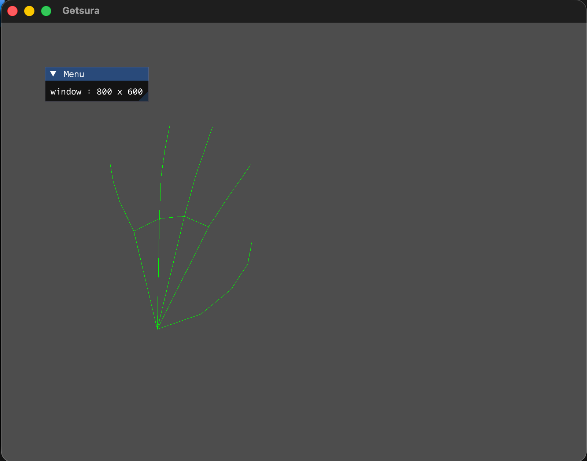

# Gestura

C++/OpenGL + ONNX Runtime setup for gesture-controlled 3D rendering 



## Dependencies
    - OpenGL APIs: gl:core=4.1
    - glad 4.1
    - C++17
    - onnxruntime-osx-arm64-1.31.1 (it works only in mac now, update it later!!)
    - opencv 5.0.0 

## Getting Started

### 1. Clone the Repository
Clone the main repository to your local machine:
```bash
git clone <repository-url>
cd <repository-folder>
```

### 2. Initialize Submodules
The project uses Git submodules, you must initialize and clone them after cloning the main repository:
```bash
git submodule update --init --recursive
```
*(Alternatively, you can clone everything at once using `git clone --recurse-submodules <repository-url>`)*

### 3. Build and Run
Configure the project with CMake, compile, and run the executable:
```bash
make run
```
## Usage
